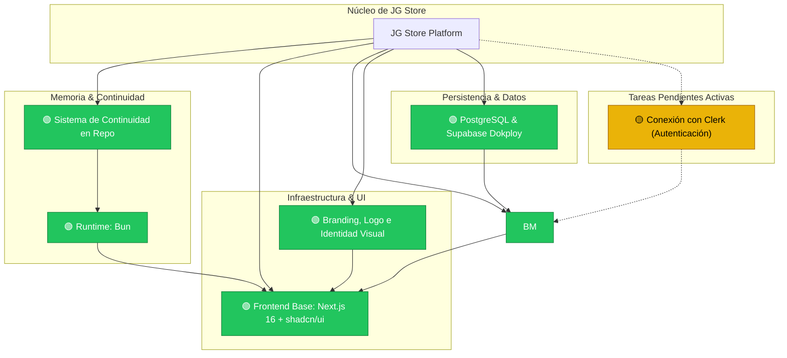

# Grafo de Conocimiento del Proyecto (Knowledge Graph)

> **PROPÓSITO PARA IAS Y DESARROLLADORES:**
> Este documento representa la memoria viva del proyecto **JG Store**. Cualquier IA o desarrollador que trabaje en este repositorio debe leer este archivo antes de realizar tareas para comprender el contexto global, las dependencias y el estado de cada módulo.

---

## 🗺️ Mapa Visual del Proyecto

---

## 🧩 Nodos del Sistema

### 1. 🟢 Base Frontend e Interfaz (`frontend-foundation`)
* **Estado:** Completado.
* **Detalles:** Integración de la plantilla `next-shadcn-dashboard-starter` con Next.js 16 (App Router), Tailwind CSS v4, componentes UI completos de shadcn/ui, tablas TanStack Table, formularios TanStack Form y gráficos Recharts.
* **Ubicación clave:** `src/app/`, `src/components/`, `src/features/`, `src/styles/`.

### 2. 🟢 Runtime y Herramientas (`package-manager`)
* **Estado:** Completado.
* **Detalles:** Uso obligatorio de **`bun`** en todo el ciclo de desarrollo (`bun install`, `bun add`, `bun dev`, `bun run build`).
* **Archivos asociados:** `bun.lock`, `.agents/skills/use-bun/SKILL.md`, `.agents/rules/prefer-bun.md`.

### 3. 🟢 Sistema de Continuidad y Memoria (`continuity-system`)
* **Estado:** Completado.
* **Detalles:** Documentación viva y reproducible en `.agents/knowledge/` y skill especializada en `.agents/skills/project-continuity/` para que el proyecto mantenga su contexto entre diferentes IAs y colaboradores.

### 4. 🟢 Consolidación de Concepto de Negocio Argentino B2B/B2C (`business-model`)
* **Estado:** Completado.
* **Detalles:**
  - Localización total para el mercado de la República Argentina (Polirrubro B2B / B2C).
  - Precios de catálogo reales en Pesos Argentinos (`$` ARS) con formateo `es-AR`.
  - **Barra de Progreso Mayorista ($ 50.000 ARS):** Desbloqueo automático de precios mayoristas en toda la orden al alcanzar el umbral de $ 50.000 ARS, o por cantidad unitaria de producto.
  - Reglas de facturación comercial AFIP/ARCA: Factura A (Responsable Inscripto con CUIT) y Factura B (Consumidor Final / Monotributo).
  - Medios de pago nacionales: Mercado Pago y Transferencia Bancaria CBU/CVU/Alias con 10% de descuento.
  - Envíos a todo el país: Andreani, Correo Argentino y Expresos de Carga al interior con despacho en CABA/GBA.
* **Referencia:** [business-rules.md](./business-rules.md).

### 5. 🟢 Branding, Logo e Identidad Visual Oficial (`branding`)
* **Estado:** Completado.
* **Detalles:** 
  - Paleta cromática oficial implementada: `#E63946` (Rojo Pasión / Principal), `#FF85A2` (Rosa Cálido / Acento), `#D4A017` (Dorado Calidad / Mayorista VIP), `#F8F8F7` / `#FFFFFF` (Superficie y Fondo Diurno), `#6C757D` (Gris Pizarra / Neutros).
  - Tipografías oficiales configuradas: **Bebas Neue Cyrillic** para Display/Títulos y **Gotham** para UI/Cuerpo/Botones.
  - Tema oficial `jg-store` registrado en `src/styles/themes/jg-store.css` y `theme.config.ts`.
  - Isotipo y Favicon oficial multiformato (`src/app/icon.png`, `public/brand/logo-icon.png`).
  - Logo oficial institucional JG-STORE POLIRUBRO con versión diurna y nocturna adaptativa en `src/components/brand/logo.tsx`.
  - Botón selector interactivo de **Modo Diurno (fondo blanco puro #FFFFFF)** y **Modo Nocturno (#111215)** integrado en el header del storefront.
  - Skill de diseño [`.agents/skills/brand-design-system/SKILL.md`](../skills/brand-design-system/SKILL.md).

### 6. 🟢 Storefront & Experiencia de Compra Dual B2B/B2C (`storefront`)
* **Estado:** Completado.
* **Detalles:**
  - 24 departamentos oficiales, Hero Banner con propuesta de valor, filtro interactivo de favoritos.
  - Carrito deslizable de gran formato (hasta 5XL) con distribución de 2 columnas en desktop, cálculo dinámico de ahorro mayorista, validación explicativa con banner de campos faltantes y checkout por WhatsApp estructurado.
  - **Buscador con disparador en Enter y Barra Lateral Estilo Mercado Libre (`SearchSidebarFilter`):**
    - La búsqueda no se ejecuta automáticamente al teclear sino que espera a que el usuario presione **Enter** o haga clic en el botón de búsqueda.
    - Al buscar o al **pulsar cualquiera de las 24 categorías oficiales**, el catálogo se reestructura automáticamente en 2 columnas estilo Mercado Libre, ocultando carruseles y banners para enfocar los productos:
      - **Columna Izquierda:** Título del rubro/término y total de resultados, chips de filtros activos con botón `x`, botón para volver a todos los departamentos, subcategorías del rubro con conteo de productos, accesos a otros departamentos, conmutadores interactivos (*En stock inmediato*, *Tarifa Mayorista B2B*, *Tienda Oficial JG*), desglose de **Marcas** con conteo de ítems, selector de **Rango de Precio** (rangos predefinidos + inputs mínimo y máximo con botón `>`), información de **Condición** (*Nuevo en caja*) y **Envíos y Despacho**.
      - **Columna Derecha:** Encabezado con migas de pan (`Inicio > Departamento > Subcategoría`), título dinámico con badge de cantidad, selector de ordenamiento y cuadrícula responsiva de tarjetas de productos.
      - **Soporte Móvil:** Botón superior *"Filtros (N)"* con drawer deslizable responsivo.
  - Sistema de favoritos (Wishlist) con Zustand y persistencia LocalStorage + migración SQL para tablas `users` y `favorites`.
  - **Página de Producto Grande estilo Mercado Libre (`/producto/[id]`):** Tira de miniaturas verticales, zoom de fotografía principal, condición y calificaciones, bloque de precios dual Detal/Mayor con % de descuento, caja de compra ("Buy Box") con botón de WhatsApp directo y botón de carrito, ficha técnica de especificaciones y sección de recomendados *"Quienes vieron este producto también compraron"*.

### 7. 🟡 Conexión con Clerk (`auth-clerk`)
* **Estado:** Pendiente.
* **Objetivo:** Conectar las claves API reales de Clerk, configurar URLs de redirección y vincular roles de usuario (administrador, cliente mayorista verificado, cliente minorista).
* **Nota importante:** Se ha dejado intencionalmente como tarea pendiente según directiva del usuario.

### 8. 🟢 Backend y Base de Datos Remota Dokploy Supabase (`backend-database`)
* **Estado:** Completado.
* **Detalles:**
  - Migración y aprovisionamiento exitoso en la instancia PostgreSQL 17.6 / Supabase Dokploy en `http://jg-store-bd.press-cloud.com` vía el endpoint de superusuario `/pg/query`.
  - Tablas instanciadas con RLS e índices B-Tree: `categories`, `subcategories`, `sub_subcategories`, `products`, `product_variants`, `users`, `favorites`, `orders`, `order_items`.
  - Vistas desnormalizadas operativas: `vw_product_hierarchy`, `vw_products_with_hierarchy`, `vw_favoritos_detalle`.
  - Seed taxonómico integral: 24 departamentos oficiales, 54 subcategorías comerciales y 90 líneas de producto específicas.
  - Catálogo inicial de 28 productos poblado con precios duales B2B/B2C en `$ ARS` y mapeo jerárquico.
  - 12 endpoints PostgREST probados y respondiendo HTTP 200 OK (`/rest/v1/*`).

### 9. 🟢 Panel de Gestión de Pedidos y Cotizaciones (`orders-management`)
* **Estado:** Completado.
* **Detalles:**
  - Panel administrativo completo en `/dashboard/orders` integrado en la barra de navegación lateral.
  - Soporte B2B y B2C en Argentina: discriminación de Factura A (CUIT) vs Factura B (DNI), medios de pago (Mercado Pago / Transferencia CBU con 10% OFF), logística a todo el país (Andreani / Correo Argentino / Expresos al interior / Retiro en depósito).
  - 4 métricas ejecutivas en `$ ARS`: Facturación total, Pedidos Mayoristas B2B, Pedidos Minoristas B2C, y Pendientes de preparación.
  - Cajón lateral interactivo `OrderDetailSheet` con desglose de ítems, cálculo de ahorro mayorista, editor de número de guía/remito y botón de contacto por WhatsApp.
  - Tabla TanStack Table con búsqueda y filtros sincronizados en URL con `nuqs`.
  - Migración SQL en `supabase/migrations/20260926_create_orders_tables.sql`.

### 10. 🟢 Limpieza de Navegación y Menús Extra (`dashboard-cleanup`)
* **Estado:** Completado.
* **Detalles:** Ocultados de `src/config/nav-config.ts` los menús demo marcados por el usuario (Workspaces, Teams, Kanban, Chat, AI Chat, sección Elements completa y Pro), dejando la barra lateral depurada y exclusiva para JG Store.

### 11. 🟢 Módulo de Configuración de la Tienda (`store-config`)
* **Estado:** Completado.
* **Detalles:** Grupo de configuración en el panel administrativo (`/dashboard/config`) con 3 submódulos interactivos y sincronización en tiempo real con el Storefront:
  1. **Información General (`/dashboard/config/general`):** Configuración del número oficial de WhatsApp (actualiza dinámicamente todos los enlaces y botones de compra del carrito, fichas y favoritos), descripción del pie de página, horarios, dirección de depósito, CUIT, email y redes sociales.
  2. **Diseño de Landing (`/dashboard/config/landing`):** Vitrina de categorías estilo SHOPLUXE con fotos miniatura circulares de productos reales (permanece visible al seleccionar categoría), gestor de carruseles de productos de costado con flechas de navegación, y **sección de visibilidad de bloques & filtros opcionales** (switches interactivos para alternar los 4 pilares de confianza del Hero Banner, la barra de categorías en texto, el filtro de Tienda Oficial JG en búsqueda y el cintillo de avisos).
  3. **Temas y Apariencia (`/dashboard/config/theme`):** Selector interactivo con vista previa de colores para las 11 paletas del sistema y selector de modo diurno (blanco) / nocturno (oscuro) / sistema.

### 12. 🟢 Jerarquía de Productos en 3 Niveles en Base de Datos y Catálogo (`hierarchical-products`)
* **Estado:** Completado.
* **Detalles:**
  - **Estructura Relacional SQL (`supabase/migrations/20261001_hierarchical_product_categories_3_levels.sql`):** Tablas `categories` (Nivel 1 - 24 departamentos oficiales), `subcategories` (Nivel 2 - subcategorías comerciales) y `sub_subcategories` (Nivel 3 - líneas específicas de producto), vinculadas a `products` con columnas opcionales, claves foráneas, índices de búsqueda y vistas desnormalizadas `vw_product_hierarchy` y `vw_products_with_hierarchy`.
  - **Dominio TypeScript (`src/types/store.ts` y `src/constants/categories.ts`):** Interfaces `SubCategory` y `SubSubCategory`, catálogo completo de las 24 categorías anidadas en 3 niveles y funciones de ayuda (`getSubcategoriesByCategory`, `getSubSubcategories`, `formatCategoryBreadcrumb`).
  - **Formulario Administrativo de Productos (`src/features/products/components/product-form.tsx`):** Selectores en cascada Nivel 1 ➔ Nivel 2 ➔ Nivel 3 con `useStore` reactivo de TanStack Form, auto-reseteo de niveles descendientes y badge de previsualización de ruta.
  - **Indexación y Búsqueda (`src/lib/search-engine.ts` y `src/lib/store-service.ts`):** Coincidencia de tokens, typos fuzzy y puntuación de sinónimos polirrubro sobre nombres y slugs de subcategorías y sub-subcategorías, además de soporte para filtrado directo.
  - **Ficha de Producto Storefront (`src/components/storefront/product-detail-view.tsx`):** Migas de pan de 3 niveles completas (`Inicio > Categoría > Subcategoría > Línea > Producto`).

### 13. 🟢 Testing Integral & Aseguramiento de Calidad E2E (`system-testing`)
* **Estado:** Completado.
* **Detalles:**
  - Suite de 33 pruebas automatizadas ejecutadas con `bun test` (0 fallos, 552 aserciones):
    - `src/tests/categories-hierarchy.test.ts`: Integridad de 24 departamentos, subcategorías Nivel 2, líneas Nivel 3 y helpers de breadcrumbs.
    - `src/tests/search-engine.test.ts`: Búsqueda exacta, typos fuzzy (Levenshtein), sinónimos polirrubro y coincidencia de 3 niveles.
    - `src/tests/whatsapp-orders.test.ts`: Formato `$ ARS`, precios detal/mayorista, umbral global $ 50.000 ARS, Factura A/B y sanitización de emojis sin `\uFE0F`.
    - `src/tests/store-service.test.ts`: Consultas con filtros de categoría, ordenamiento, stock y ciclo de vida CRUD.
    - `src/tests/e2e-http-routes.test.ts`: Validación de respuesta HTTP 200 en storefront, detalle de producto, dashboard y configuración.
  - Script `"test": "bun test"` registrado en `package.json` para ejecución instantánea.

### 14. 🟡 Interfaz de Configuración de Cuenta de Cliente No Administrador (`customer-account-settings`)
* **Estado:** Pendiente prioritaria solicitada por el usuario.
* **Objetivo:** Portal y vista de cuenta de usuario no administrativo (`/cuenta` o `/perfil-cliente`), independiente del panel de control de administración (`/dashboard`).
* **Módulos incluidos:**
  - **Datos Personales y Fiscales:** Edición de Nombre, Razón Social, CUIT/DNI, Teléfono/WhatsApp y tipo de factura por defecto (A o B).
  - **Libreta de Direcciones:** Guardado de domicilios de entrega (localidad, código postal, calle, expreso habitual) con auto-completado en el checkout.
  - **Historial de Pedidos:** Registro y seguimiento de cotizaciones y pedidos enviados por WhatsApp con remitos y estados.
  - **Seguridad y Nivel de Cuenta:** Gestión de contraseña y condición comercial (Cliente Detal B2C / Mayorista B2B VIP Verificado).

### 15. 🟢 Módulo Scraper Coronel Mayorista & Terminal en Vivo (`coronel-scraper`)
* **Estado:** Completado (Paso 1 Local + Cloud Dokploy noVNC).
* **Detalles:**
  - Código base clonado y adaptado en `scraping-coronel/` con entorno virtual Python y Selenium para navegación interactiva con Google Chrome.
  - Sustitución de Tkinter por señal en archivo `.scraper_continue` emitible desde el panel web.
  - Capturas periódicas en `preview.png` y transmisión continua para visualización del navegador.
  - **Despliegue Cloud en Dokploy (`uJJ_UD7QnPV9FrDO5fsKR`):** Microservicio Docker independiente en el proyecto `JG-STORE` corriendo Python 3.11, Google Chrome (`--no-sandbox`), `Xvfb` (pantalla virtual :99), `x11vnc`, `noVNC` y `FastAPI`, unificado bajo Nginx en el puerto 80 en el dominio `coronel.press-cloud.com`.
  - **Visor Interactivo Remoto (Opción A):** Integrado en el panel `/dashboard/coronel` mediante `<iframe>` noVNC con controles de escalado y zoom ajustable (`50%`, `75% Ideal`, `100%`, `125%`, `Fit`), relación de aspecto 16:10 sin barras de scroll (`scale=true`), botón de pantalla completa, y terminal colapsable, permitiendo interactuar con el ratón sobre la página de Coronel Mayorista directamente desde la web, confirmar la categoría, presionar "CONTINUAR SCRAPING" y apagar la PC mientras el proceso continúa en el servidor.
  - **Seguridad y Tokens:** Autenticación estricta con contraseña en `x11vnc`, redirección a tienda principal en raíz de Nginx, validación de token de sesión en `/vnc/` y middleware HTTP Bearer en FastAPI.
  - **Descarga Robusta de Excel:** Configuración de `Page.setDownloadBehavior` (allow) vía CDP en Selenium y búsqueda flexible insensible a mayúsculas y guiones para `lista-precios-*.xlsx` con verificación de temporales `.crdownload`.
  - **Aceleración Extrema por Inyección JS:** Extracción de productos en 5ms por página mediante `document.querySelectorAll` inyectado en vez de llamadas remotas múltiples de Selenium, y descarga asíncrona de fotos en pool de hilos (`ThreadPoolExecutor`).
  - **Detección Limpia de Fin de Catálogo:** Manejo automático de páginas sin resultados o con "No encontramos resultados para tu búsqueda" en `scraping_product.py`, finalizando con `[SCRAPER_STATUS:COMPLETED]` sin fallos de `TimeoutException`.
  - **Arquitectura de Costo Original y Márgenes Duales (B2B & B2C):** Guardado de `precio_costo` original del proveedor, margen minorista / detal (B2C, %) y mayorista (B2B, %), con cálculo y persistencia de `precio_minorista` y `precio_mayorista`. Toolbar en `/dashboard/coronel` y endpoint `/api/products/margins` para recálculo masivo instantáneo (0.01s) sin re-scrapear.
  - **Réplica Taxonómica de 3 Niveles y Soporte Infinito Retrocompatible:** Extracción desde migas de pan (`.breadcrumb2`) y árbol de Coronel con soporte para cualquier profundidad N (`categoria_niveles` JSON), manteniendo retrocompatibilidad total con `categoria`, `subcategoria` y `sub_subcategoria`.
  - Paso 2 (Sincronización remota a Tiendanube) pausado deliberadamente por indicación comercial del usuario.

### 16. 🟢 Gestor Masivo de Márgenes y Arquitectura de Costos (`bulk-margin-manager`)
* **Estado:** Completado.
* **Detalles:**
  - Toolbar ejecutiva `BulkMarginToolbar` integrada en `/dashboard/product`.
  - Recálculo masivo e instantáneo de PVP Detal y PVP Mayor aplicando márgenes comerciales (%) sobre el costo base (`cost_price`).
  - Capacidad de aplicar a todo el catálogo o por departamento/categoría específica.
  - Endpoint `/api/products/margins` y función RPC en Supabase `recalculate_product_margins`.
  - Columnas de la tabla de productos transparentando costo y margen comercial (`Costo: $X (+40%)`).

### 17. 🟢 Persistencia Pre-WhatsApp y Precios Históricos Fijos Quemados (`orders-persistence-snapshots`)
* **Estado:** Completado.
* **Detalles:**
  - Endpoint `POST /api/orders` que persiste la orden en backend antes de abrir WhatsApp.
  - Generación de identificador correlativo nacional (ej. `#JG-2026-0001`) inyectado en el mensaje de WhatsApp.
  - Vaciado de carrito tras confirmación de pedido.
  - Snapshot Pattern ("precios quemados"): cada renglón de pedido almacena inmutablemente `unit_price`, `cost_price_at_sale` y `category_snapshot`, desacoplando las órdenes de futuros cambios de precios en catálogo.
  - Ficha de pedido interactiva en `/dashboard/orders` (`OrderDetailSheet`) con edición de ítems (+ / - / borrar), recálculo de montos y consolidación de pago.

### 18. 🟢 Sincronizador ETL de Catálogo SQLite ➔ Supabase & Filtros Jerárquicos (`catalog-migration-and-filters`)
* **Estado:** Completado.
* **Detalles:**
  - **Centro de Migración en `/dashboard/coronel`:** Transformación de la sección inferior de SQLite en un centro activo de migración y publicación al catálogo web oficial.
  - **Endpoint ETL `/api/scraper/migrate`:** Lectura de productos desde SQLite o microservicio remoto de scraping, auto-creación recursiva de categorías (Nivel 1), subcategorías (Nivel 2) y líneas (Nivel 3) en PostgreSQL / Supabase Dokploy si no existen, y upsert de productos por SKU / `codigo` evitando duplicados.
  - **Toolbar de Filtros Jerárquicos en `/dashboard/product` (`ProductHierarchyFilters`):** Selectores en cascada Nivel 1 (Departamento) ➔ Nivel 2 (Subcategoría) ➔ Nivel 3 (Línea de producto), buscador global por texto, selector de estado de stock (En stock, Stock crítico, Agotado), y badges reactivos de filtros activos con botón de limpieza global.

### 19. 🟢 Sincronización Dinámica de Subcategorías & Conectividad Supabase PostgREST (`catalog-dynamic-sync`)
* **Estado:** Completado.
* **Detalles:**
  - **Resolución de Autenticación Supabase:** Corregida variable en Dokploy (`ANON_KEY` a `NEXT_PUBLIC_SUPABASE_ANON_KEY`) e implementado `DEFAULT_SUPABASE_ANON_KEY` en `src/lib/store-service.ts` para garantizar acceso permanente en cliente y servidor sin bloqueos 401.
  - **Subcategorías Dinámicas:** Creación de endpoint `/api/categories` y función `fetchStoreCategories()` que combina en tiempo real los 24 departamentos base con todas las subcategorías y líneas creadas durante la migración (ej. `LENCERIA`, `PANTUFLAS Y PANTUMEDIAS`).
  - **Filtros y Márgenes Reactivos:** `ProductHierarchyFilters` y `BulkMarginToolbar` ahora consumen `/api/categories`, permitiendo filtrar y ajustar márgenes sobre subcategorías extraídas de proveedores sin necesidad de reiniciar la app.
  - **Rutas API Conectadas:** Actualizadas `/api/products` y `/api/products/[id]` para delegar en el servicio de catálogo real de PostgreSQL.

### 20. 🟢 Almacenamiento Persistente en Supabase Storage (Bucket S3) (`supabase-storage-images`)
* **Estado:** Completado.
* **Detalles:**
  - **Bucket Público `products`:** Creado y validado bucket S3 público en Supabase Storage Dokploy.
  - **Migración Masiva Realizada:** 342 productos en PostgreSQL actualizados con URLs directas de Supabase Storage en lugar del servidor externo `imgcoronel.dyndns.org:70`.
  - **Carga en Scraper y ETL:** `_descargar_imagen_async` en Python y `/api/scraper/migrate` en Next.js suben las imágenes a Supabase Storage por defecto, garantizando independencia total de servidores externos.
  - **Configuración Next.js Image:** Añadido soporte de puertos y dominios para optimización segura con cero errores 500.

### 21. 🟢 Extracción en Profundidad (`app-articulo`), Galería Multi-Imagen y Marca Auténtica (`deep-scraping-gallery-and-brand`)
* **Estado:** Completado.
* **Detalles:**
  - **Extracción Profunda en Selenium (`scraping_product.py`):** El scraper ahora entra a la ficha detallada (`app-articulo`) de cada producto para capturar la jerarquía auténtica del breadcrumb (`#breadcrumb .breadcrumb-item.breadcrumb2`) y todas las imágenes de la galería (`.gallery img.img-gallery, .gallery-item img`).
  - **Jerarquía Taxonómica de 4 Niveles:** Desglose exacto en Categoría (Nivel 1), Subcategoría (Nivel 2), Línea (Nivel 3) y Marca (`brand`, Nivel 4, ej. `COCOT`).
  - **Galería Multi-Imagen en Supabase Storage:** Descarga asíncrona de todas las fotos de cada artículo y subida persistente a Supabase Storage (`${sku}.jpg`, `${sku}_1.jpg`, etc.).
  - **Almacenamiento Local SQLite (`productos.db`):** Columnas `imagenes_galeria` (JSON) y `marca` integradas en `asegurar_tabla_productos`, `consolidar_productos`, `export_products_json.py` y `api_server.py`.
  - **Esquema PostgreSQL en Supabase:** Agregada columna `images jsonb DEFAULT '[]'::jsonb` a `products`.
  - **Sincronización Web por SKU (`/api/scraper/migrate`):** Identificador maestro único por SKU: crea o actualiza (`PATCH`) taxonomía, marca, galería de Supabase Storage y precios detal/mayor sin duplicados.
  - **UI Dashboard & Storefront:** Indicador de conteo de fotos (`+N`), badge de marca oficial, y visualización de galería real en `ProductDetailView`.

### 22. 🟢 Actualización Automática de Stock, Cron Scheduler y Timers de Benchmarking (`automated-stock-cron-and-benchmarking`)
* **Estado:** Completado.
* **Detalles:**
  - **Modo 100% Desatendido (`auto_mode=True`):** Supresión de cuadros de diálogo y esperas manuales en `actualizar_stock.py` pasando `-y` y `show_button=False` al autenticador de Selenium, permitiendo ejecuciones autónomas programadas.
  - **Detección y Ocultación de Discontinuados:** Al barrer todo el catálogo de Coronel Mayorista (~680 páginas), los productos presentes en la base de datos (SQLite y PostgreSQL) que no aparezcan en la extracción actual reciben automáticamente `stock = 0`, marcándolos como agotados y ocultándolos de la vista en tienda.
  - **Sincronización Dual Directa:** Actualización atómica en `productos.db` (SQLite) y en la tabla `products` de Supabase Dokploy mediante PostgREST (`PATCH /products?sku=eq.{sku}`) concurrente con `ThreadPoolExecutor(max_workers=8)`.
  - **Preservación de Márgenes Establecidos:** No impone ni solicita porcentajes por parámetro. Si el costo del proveedor varió, el recálculo matemático de los precios se efectúa de manera 100% automática respetando el margen establecido en cada producto; si el costo no cambió, se actualiza el stock preservando intactos los precios.
  - **Timers y Benchmarking de Rendimiento:** Cronometraje detallado por función (login, tiempo de scrape por página, tiempo acumulado, sincronización SQLite, sincronización Supabase y duración total) formateado en minutos/segundos (`⏱️ [CRONÓMETRO]`).
  - **Programador Cron en Background:** `CronManager` integrado en `api_server.py` con persistencia en `cron_config.json`, loop asíncrono y endpoints de gestión (`/api/cron`, `/api/cron/run`).
  - **Panel de Control Web (`/dashboard/coronel`):** Módulo interactivo con switch para habilitar/deshabilitar cron, selector de intervalo (1h, 3h, 6h, 12h, 24h), monitoreo de última y próxima corrida, y botón para ejecución inmediata.

### 23. 🟢 Códigos de Barra Oficiales EAN-13 (Excel Coronel) y Migración Schema (`barcode-excel-enrichment`)
* **Estado:** Completado.
* **Detalles:**
  - **Migración de Base de Datos en Supabase Dokploy:** Agregadas formalmente las columnas `cost_price NUMERIC(14, 2) DEFAULT 0.00`, `barcode VARCHAR(100)` y `supplier_code VARCHAR(100)` a la tabla `public.products`.
  - **Sincronización Inmediata con Excel de Coronel:** Mapeo de los 346 productos existentes en Supabase contra la lista de precios oficial (`lista-precios-*.xlsx` con 23.208 artículos): 318 productos enriquecidos exitosamente con su código de barra numérico auténtico EAN-13 (8 a 14 dígitos) y su precio de costo base.
  - **Robustecimiento de `actualizar_stock.py` y Auto-migración Canónica de SQLite (`asegurar_tabla_productos`):**
    - Delegación de la inicialización y migración de SQLite a `asegurar_tabla_productos()`, eliminando esquemas fragmentados.
    - Ampliado el chequeo de PRAGMA a las 33 columnas completas de la tabla (incluyendo `precio`, `codigo_barra`, `imagen_url`, `imagen_local`, `variante`, `subcategoria`, etc.) con ejecución automática de `ALTER TABLE productos ADD COLUMN` para garantizar compatibilidad hacia atrás en cualquier base preexistente.
    - Resuelve el error `no such column: precio` durante la consolidación de productos en `scraping_coronel.py` y previene el fallo secundario `object of type 'bool' has no len()`.
    - Módulos `cargar_mapa_excel()` y `buscar_en_excel_map()` para leer el último Excel descargado en cada corrida y vincular automáticamente `barcode` y `cost_price`.
    - Resiliencia en consultas PostgREST con selección de campos segura y actualización en paralelo.
  - **Interfaz de Usuario y Visualización:**
    - Componente de icono centralizado `Icons.barcode` (`IconBarcode` de `@tabler/icons-react`).
    - Columna SKU en el panel administrativo (`/dashboard/product`) muestra el badge del código de barra EAN-13.
    - Vista de detalle de producto en la tienda (`ProductDetailView`) exhibe el código EAN junto al SKU y la categoría.

### 24. 🟢 Arquitectura de Pestañas Modulares y Monitor Especializado de Stock (`coronel-tabbed-dashboard-and-stock-monitor`)
* **Estado:** Completado.
* **Detalles:**
  - **Reorganización en Pestañas Dedicadas (`/dashboard/coronel`):**
    - **Pestaña 1: "Extracción Manual de Catálogo":** Enfocada exclusivamente en la extracción de nuevos productos y categorías con controles interactivos noVNC (escalado, zoom 50%-125%, pantalla completa), terminal colapsable en vivo, selectores de margen inicial y el ETL masivo *"CENTRO DE MIGRACIÓN & PUBLICACIÓN AL CATÁLOGO WEB"*. Se ocultaron los modos redundantes ("Solo Actualizar Stock" y "Pipeline Completo") para evitar confusiones operativas.
    - **Pestaña 2: "Sincronización Automática de Stock (Cron & Existencias)":** Módulo autónomo con guía conceptual de 4 pilares (barrido de ~726 páginas, preservación de márgenes, detección de productos discontinuados con `stock = 0`, y enriquecimiento con códigos EAN-13 del Excel).
  - **Métricas Ejecutivas y Auditoría en Tiempo Real:**
    - Tarjetas de conteo: Total escaneado, Activos con stock, Discontinuados (`stock = 0`), Precios recalculados automáticamente y Códigos EAN-13 vinculados.
    - Banner de confirmación de salud: `✓ 100% Sincronizado con Supabase PostgREST` y duración total del proceso.
    - Tabla histórica de auditoría (últimas 20 ejecuciones) con marca de tiempo, modo, métricas resultantes, tiempo transcurrido y estado.
  - **Monitor de Existencias y Discontinuados en la Web:**
    - Reemplazo especializado de la sección inferior en la pestaña de stock, mostrando contadores en vivo de la base de datos Supabase Dokploy (Total, Activos con stock, Agotados/Discontinuados, Sincronizados con EAN-13), políticas de stock y enlaces directos al catálogo.
  - **Persistencia de Auditoría:** `stock_sync_stats.json` gestionado por `actualizar_stock.py` y expuesto por `api_server.py` (`GET /api/cron`) con fallback automático a métricas de SQLite si no existe registro previo.

### 25. 🟢 Barra de Comando Unificada de Catálogo & Gestor de Precios (`product-command-bar`)
* **Estado:** Completado.
* **Detalles:**
  - **Fusión Arquitectónica:** Unificación de `BulkMarginToolbar` y `ProductHierarchyFilters` en un solo componente ergonómico `ProductCommandBar` en `/dashboard/product`.
  - **Selector Jerárquico en Árbol Indentado:** Eliminación de los 3 selectores en cascada (Depto ➔ Subcat ➔ Línea) en favor de un menú desplegable directo con `optgroup` y niveles `└─ Subcategoría` y `└── Línea`.
  - **Acciones Masivas Contextuales:** Vinculación directa entre el filtro activo de la tabla y la herramienta de márgenes, adaptando el botón de recálculo dinámicamente (`Aplicar Márgenes a "Categoría" (N prods)` o `Todo el Catálogo`).
  - **Soporte de Profundidad en Backend:** Ampliado `updateStoreProductMarginsMassive` en `src/lib/store-service.ts` para abarcar también coincidencias sobre `sub_subcategory_slug`.

### 26. 🟢 Vaciado Seguro de Catálogo y Categorías (`catalog-reset-dialog`)
* **Estado:** Completado.
* **Detalles:**
  - **Endpoint de Purgado `/api/catalog/reset`:** Limpieza atómica y segura de las tablas relacionales en PostgreSQL / Supabase Dokploy (`favorites`, `product_variants`, `products`, `sub_subcategories`, `subcategories`, `categories`) y recarga del schema de PostgREST.
  - **Vaciado de Scraper SQLite:** Endpoint `/api/products/reset` en `api_server.py` y limpieza local de `productos.db` (`DELETE FROM productos; VACUUM;`).
  - **Componente Modal con Cuenta Regresiva de 5s (`CatalogResetDialog`):** Diálogo interactivo con temporizador de seguridad de 5 segundos, detalles explícitos de eliminación y botón de confirmación con bloqueo temporal para evitar borrados accidentales.
  - **Integración Dual:** Disponible tanto en el Centro de Migración de `/dashboard/coronel` como en la barra de comando de `/dashboard/product`.
  - **Catálogo Limpio:** Base de datos web purgada exitosamente a 0 productos y 0 categorías para pruebas limpias de extremo a extremo.

### 27. 🟢 Mesa de Trabajo Interactiva SQLite & Estrategia de Precios en Migración (`coronel-interactive-table-and-price-strategy`)
* **Estado:** Completado.
* **Detalles:**
  - **Estrategia de Precios para Coincidentes (`/api/scraper/migrate`):**
    - Selector tri-estado para el proceso de migración: `🛡️ Solo Nuevos (Respetar Precios Existentes)` [Recomendado], `🔄 Sobrescribir Todo` y `📦 Solo Stock en Existentes`.
    - Garantiza que al extraer nuevamente una categoría de Coronel, los productos existentes en Supabase no pierdan los precios o márgenes personalizados que el comerciante ya les fijó en la tienda online.
    - Contador de auditoría de precios preservados retornado en la respuesta JSON y en la notificación toast.
  - **Mesa de Trabajo Interactiva SQLite en `/dashboard/coronel`:**
    - Barra de filtros en vivo por texto (SKU, código de barras o descripción), categoría con contador individual y estado de stock (Todos, Con Stock, Agotados).
    - Selección múltiple de productos (checkbox maestro + individuales por fila).
    - Barra flotante contextual de acciones masivas: fijar stock masivo (`POST /api/scraper/products/stock`), aplicar márgenes a seleccionados (`POST /api/scraper/products/margins`) y eliminación en lote (`DELETE /api/scraper/products`).
    - Input de stock físico editable inline en cada celda con persistencia automática al pulsar Enter o salir del campo.
    - Botón de eliminación individual por fila (`🗑️`) con confirmación.
    - Autodetección de `.venv/bin/python` para ejecución local resiliente en entornos Node/Next.js.

### 28. 🟢 Mesa de Trabajo Interactiva en Catálogo Oficial de Supabase (`product-table-interactive-worktable`)
* **Estado:** Completado.
* **Detalles:**
  - **Selección Múltiple y Pinning en TanStack Table (`/dashboard/product`):** Checkbox maestro en el encabezado para seleccionar todos los productos de la página visible, checkboxes individuales por fila, y pinning fijado a la izquierda (`select`) y a la derecha (`actions`).
  - **Barra Flotante / Contextual de Acciones Masivas:** Se despliega con animación y sombra superior cuando hay 1 o más productos seleccionados:
    - Contador de selección en badge rojo + botón "Deseleccionar".
    - 📦 *Fijar Stock Masivo*: input numérico y botón para actualizar el stock físico en Supabase de todo el lote seleccionado en un solo clic (`POST /api/products/stock`).
    - 💲 *Fijar Márgenes Masivos*: inputs de margen Detal (%) y Mayorista (%) para recalcular y aplicar precios según el costo individual de cada producto seleccionado (`POST /api/products/margins`).
    - 🗑️ *Eliminación Masiva*: botón con conteo de seleccionados y modal de confirmación `AlertModal` para purgar los productos en lote de Supabase (`DELETE /api/products`).
  - **Edición Inline de Stock Físico:** Celda interactiva en la columna de stock con número editable, semáforo visual (rojo = agotado, ámbar = bajo, verde = normal) y guardado automático con Enter o `onBlur` en Supabase con indicador de spinner.
  - **Acción Directa de Eliminación:** Botón visible `🗑️` por fila con diálogo `AlertModal` para suprimir artículos individuales sin necesidad de abrir el menú desplegable.
  - **Capa de Servicios y Rutas Backend:** Nuevos métodos `updateStoreProductsStock`, `deleteStoreProducts` y `updateStoreProductsMargins` en `src/lib/store-service.ts` con soporte para filtros `id=in.(...)` de PostgREST, y endpoints `POST /api/products/stock` y `DELETE /api/products`.

